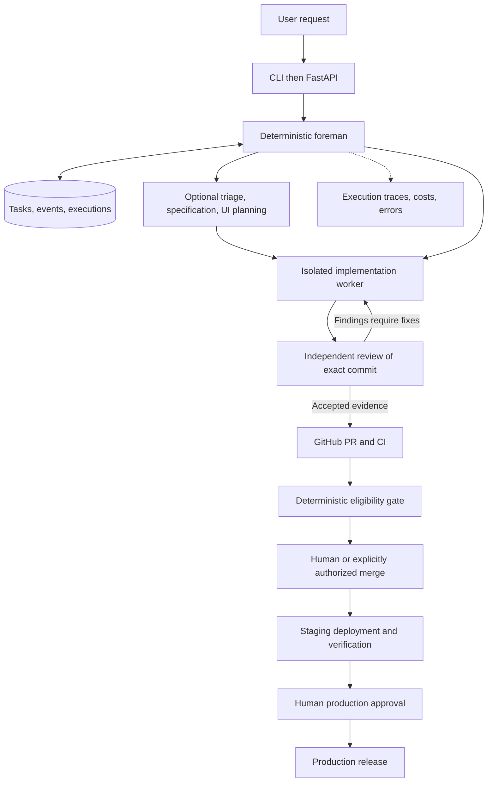

# Architecture

## Current implementation

The active application is src/ai_factory/api.py, an installable FastAPI service with a liveness endpoint. It intentionally has no deployment endpoint or worker authority. CI validates application code plus the preserved regression exercises. This is the application/CI foundation, not yet an integrated agent workflow.

## Next vertical slice

Request API -> persisted run -> deterministic orchestrator -> provider-backed planner -> bounded implementation worker -> independent review -> GitHub PR evidence. Define typed results and permission boundaries before wiring real providers. The factory repository and target application repository remain separate. Independent tasks may run concurrently; review depends on a completed immutable commit. Workers will not share one mutable checkout.

## Preserved lesson implementation

The Lesson 1 demo remains in memory. Lesson 2 adds a CLI and SQLite adapter: tasks stores current state; events stores ordered state-entry records and UTC timestamps. State updates and history inserts commit atomically. A separate Python process can reload them. No automatic recovery, agent execution, or external side effects are implemented. Persistent state is not yet a durable workflow engine.

## Initial functional target

One Python application with a deterministic foreman, SQLite task/event storage, and fake implementation and review workers. Start with a CLI, then add FastAPI as an input adapter. No microservices or agent framework required.

The diagram shows the target, not current capabilities. The foreman owns workflow progression; arrows between workers represent information flow, not permission to schedule or approve their own work.

## Responsibilities

Agent orchestration concerns task context, model selection, allowed tools, specialist routing, and feedback. Workflow orchestration concerns legal progression, persistence, retries, deadlines, and human approval waits. LLMs propose; deterministic policy controls consequential actions.

Intake and triage may share one structured LLM call. Specification and UI planning are optional artifacts, not mandatory services. Implementation proposes changes; review independently evaluates a fixed commit. Foreman scheduling, evidence validation, budgets, and release eligibility should be deterministic. Release summaries may use an LLM, but authorization cannot rely on their prose.

Workers exchange typed results containing task ID, execution ID, schema version, status, artifact references, and later commit SHA. The database stores authoritative state; messages notify workers of work. Avoid conversational shared memory as the system of record.

## Recovery target

Persist state changes and events in one transaction. A later worker claims a step with a lease; after a crash, expired work becomes eligible for bounded retry. A crash after an external side effect but before recording success requires idempotency or reconciliation, not blind replay. Add a transactional outbox when database updates must also publish messages.

## GCP evolution (proposed)

- Cloud Run service: FastAPI intake and authenticated webhook handling.
- Cloud Run jobs: trusted, finite execution units. A job or container alone is not a sufficient sandbox for arbitrary hostile code; enforce separate credentials, filesystem, network, and execution limits before real repository execution.
- Cloud SQL PostgreSQL: shared transactional task/event store. SQLite stays local; do not use Cloud Run instance files as durable shared storage.
- Cloud Tasks: controlled delivery to a specific worker endpoint.
- Pub/Sub: fan-out of facts such as task completion to independent consumers, when needed.
- Workflows: later trial for coarse release orchestration; retain one owner per workflow state, not competing Python and Workflows retry loops.
- Secret Manager and separate service accounts: bounded credentials. GitHub Actions uses Workload Identity Federation when cloud deployment is introduced.

## Example

Synthetic request: add a pure slugify function and tests. Triage marks a small backend change and skips UI planning. Implementation creates a patch in an isolated synthetic repository. Review finds an empty-input bug at commit A. Implementation produces commit B; review A cannot approve B. Review B and CI B must pass before eligibility. A human authorizes merge; the approved build goes to staging, is verified, and waits for human production approval. No part of this example has been executed yet.

## Safety boundaries to implement before external use

Separate implementer, reviewer, policy gate, and release identities. Immutable review evidence binds repository and exact commit SHA. A new commit invalidates old acceptance. Repository text and tool output are untrusted data, never authority to expand tools. No secrets in model context or logs. Protect workflow files with human review. Verify webhook signatures and deduplicate delivery IDs. Agents cannot approve their own work or bypass checks. Production always requires human approval.
